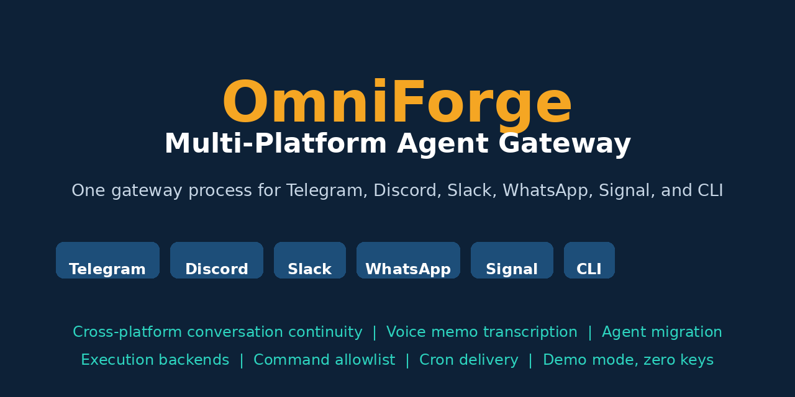
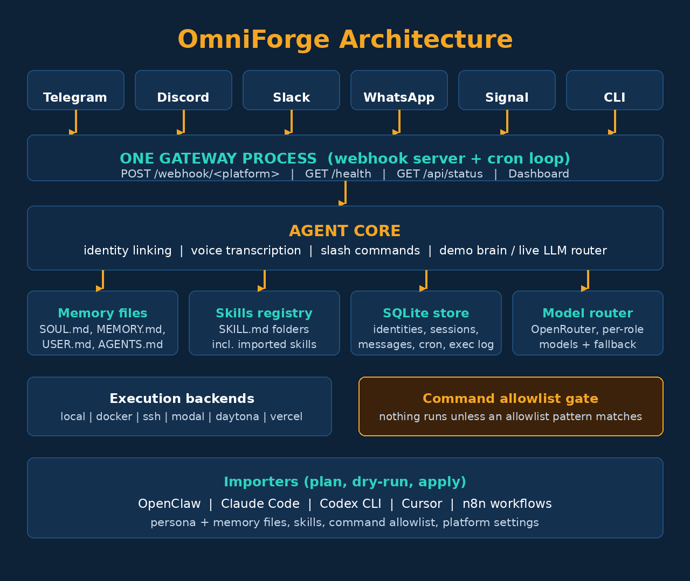
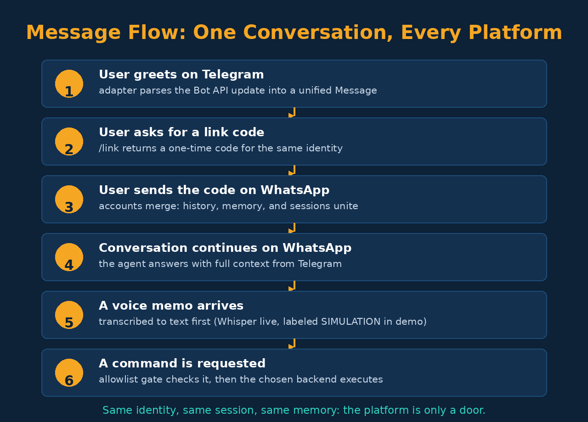
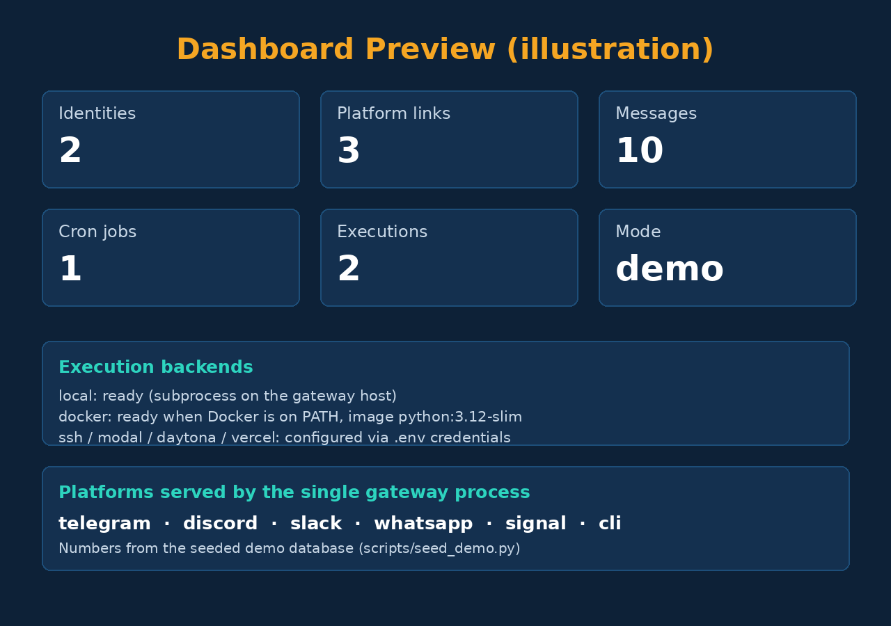

# OmniForge — Multi-Platform Agent Gateway



**One agent, every platform.** OmniForge is a personal AI agent gateway
that serves **Telegram, Discord, Slack, WhatsApp, Signal, and a CLI**
from **a single gateway process**, with cross-platform conversation
continuity, voice memo transcription, multiple execution backends, a
command allowlist security gate, scheduled jobs, and one-command
migration from other agents (OpenClaw, Claude Code, Codex CLI, Cursor,
and n8n).

It runs end-to-end with **zero API keys** in a deterministic demo mode,
and goes live per platform as you add tokens. Pure Python 3.10+
standard library, no third-party dependencies.

## Contents

- [What it does](#what-it-does)
- [Architecture](#architecture)
- [Quickstart](#quickstart)
- [Platforms and webhooks](#platforms-and-webhooks)
- [Cross-platform continuity](#cross-platform-continuity)
- [Voice memos](#voice-memos)
- [Execution backends](#execution-backends)
- [Migrating from another agent](#migrating-from-another-agent)
- [Commands](#commands)
- [Cron](#cron)
- [Dashboard](#dashboard)
- [Evaluation](#evaluation)
- [Project structure](#project-structure)
- [Road to SaaS](#road-to-saas)
- [Limitations](#limitations)
- [License](#license)

## What it does

- **Single gateway process** — one webhook server receives every
  platform, normalizes payloads into a unified message, runs one agent
  core, and replies through each platform's own channel.
- **Conversation continuity** — link your accounts once with a code and
  your identity, history, memory, and sessions are shared across all
  platforms. Start on Telegram, continue on WhatsApp, finish on the CLI.
- **Voice memo transcription** — voice notes on Telegram, WhatsApp, and
  Signal are transcribed to text before the agent processes them
  (Whisper API in live mode; a clearly labeled SIMULATION in demo mode).
- **Many execution backends** — local, Docker, and SSH really execute;
  Modal, Daytona, and Vercel Sandbox are configured adapters that
  refuse with clear setup guidance until credentials exist.
- **Command allowlist** — nothing executes unless it matches an
  allowlist pattern. The allowlist is seeded with safe defaults and
  grows through imports.
- **Agent migration** — import persona and memory files (SOUL.md,
  MEMORY.md, USER.md, AGENTS.md), skills, command allowlists, and n8n
  workflows from OpenClaw, Claude Code, Codex CLI, and Cursor, always
  with a dry-run preview first.
- **Cron with delivery** — scheduled prompts run on the gateway's cron
  loop and the answer is delivered back to the originating platform.
- **Memory and skills** — file-based persistent memory plus a skills
  registry (one SKILL.md per folder, recursively scanned, including
  imported skills).

## Architecture





Each adapter only does two things: parse its platform's payload into a
unified `Message`, and send a reply. Everything else (identity,
sessions, memory, skills, transcription, execution, cron) lives in the
shared core, so behavior is identical on every platform.

## Quickstart

No keys needed:

```bash
python -m omniforge doctor            # config and stats summary
python scripts/run_demo.py            # full end-to-end demo scenario
python -m omniforge chat              # talk via the CLI platform
python -m omniforge gateway           # serve all platforms on :8787
python -m unittest discover -s tests  # 22 tests
python evaluation/run_evaluation.py   # 10 end-to-end checks
```

Try the migration on the bundled sample export:

```bash
python -m omniforge import-agent openclaw --path data/samples/imports/openclaw --dry-run
python -m omniforge import-agent openclaw --path data/samples/imports/openclaw
python -m omniforge import-agent n8n --path data/samples/imports/n8n
```

Docker:

```bash
docker build -t omniforge .
docker run -p 8787:8787 omniforge
```

## Platforms and webhooks

Point each platform at the same running gateway:

| Platform | Webhook | Live sending needs |
| --- | --- | --- |
| Telegram | `POST /webhook/telegram` | `TELEGRAM_BOT_TOKEN` (Bot API) |
| WhatsApp | `POST /webhook/whatsapp` | `WHATSAPP_TOKEN` + `WHATSAPP_PHONE_ID` (Cloud API) |
| Slack | `POST /webhook/slack` | `SLACK_BOT_TOKEN` (Events API) |
| Discord | `POST /webhook/discord` | `DISCORD_WEBHOOK_URL` |
| Signal | `POST /webhook/signal` | signal-cli REST bridge (`SIGNAL_API_BASE`, `SIGNAL_NUMBER`) |
| CLI | `POST /webhook/cli` or `omniforge chat` | nothing |

Without tokens (demo mode), replies are recorded in each adapter's
outbox instead of being sent, so the full flow is testable offline.
Sample payloads for every platform live in `data/samples/payloads/`.

## Cross-platform continuity

1. On platform A: send `/link` and receive a one-time code.
2. On platform B: send `/link <CODE>`.
3. The accounts merge into one identity: message history is moved,
   sessions unify, and the agent's later answers reference context from
   both platforms (the demo shows this explicitly).

## Voice memos

Voice messages are detected per platform (Telegram `voice`, WhatsApp
`audio`, Signal audio attachments), transcribed, and then processed as
text. Live mode calls an OpenAI-compatible `/audio/transcriptions`
endpoint. Demo mode returns a deterministic phrase per media id and
labels the reply as a simulation; it never pretends to be real ASR.

## Execution backends

| Backend | Status |
| --- | --- |
| local | Works: subprocess on the gateway host |
| docker | Works when Docker is on PATH (`DOCKER_IMAGE` configurable) |
| ssh | Works with `SSH_HOST` configured (key-based, BatchMode) |
| modal / daytona / vercel | Configured adapters; refuse with setup guidance until credentials are set (full serverless execution is Fase 2 of the roadmap) |

Every execution passes the **allowlist gate** first
(`data/live/allowlist.json`, safe defaults: `echo`, `date`, `whoami`,
`ls`, `pwd`, `uname`) and is written to the execution log. Try:

```text
/jalan echo hello           -> runs
/jalan rm -rf /             -> rejected by the allowlist
/backend docker             -> switch the active backend
```

## Migrating from another agent

```bash
python -m omniforge import-agent openclaw [--path ~/.openclaw] [--dry-run]
python -m omniforge import-agent claude-code
python -m omniforge import-agent codex
python -m omniforge import-agent cursor
python -m omniforge import-agent n8n --path ./n8n-exports
```

What moves: SOUL.md, MEMORY.md, USER.md, and AGENTS.md into
`data/live/memory/` (Claude Code's CLAUDE.md becomes AGENTS.md; Cursor
rules are copied as memory files), skills into
`data/live/skills/<source>-imports/`, the command allowlist merged into
the gateway allowlist, and each n8n workflow converted into an
explanatory skill with its schedule triggers noted as cron candidates.
Every import is plan-first: `--dry-run` prints exactly what would
happen and writes nothing.

## Commands

| Command | Effect |
| --- | --- |
| `/link` / `/link <CODE>` | create or redeem a cross-platform link code |
| `/platform` | list platforms linked to your identity |
| `/skills` | list available skills |
| `/ingat <note>` | append a note to MEMORY.md |
| `/jalan <command>` | execute on the active backend (allowlist-gated) |
| `/backend <name>` | switch execution backend |
| `/cron tambah <schedule> <prompt>` | schedule a job (`every:<seconds>` or `daily:<HH:MM>`) |
| `/cron` | list scheduled jobs |
| `/status` | system summary |
| `/baru` | start a fresh session |
| `/help` | command list |

## Cron

Jobs are stored in SQLite and checked by the gateway loop every few
seconds. When a job is due, its prompt runs through the same agent core
and the reply is delivered to the job's platform and chat. Schedules:
`every:<seconds>` repeats; `daily:<HH:MM>` fires once a day (UTC).

## Dashboard



*(Illustration with numbers from the seeded demo database.)*

`dashboard/` is a static page served by the gateway at `/`. It reads
`/api/status` when the gateway is live and falls back to
`dashboard/data/status.json`, which is generated from the seeded
database by `scripts/seed_demo.py`.

## Evaluation

`evaluation/run_evaluation.py` runs 10 deterministic end-to-end checks:
parsing on all six platforms, simulated voice transcription,
cross-platform continuity after linking, wrong-code rejection, allowed
execution, dangerous execution rejection, OpenClaw dry-run import, n8n
import, cron due logic, and memory persistence. Current result:
**10/10 passed**, with **22/22 unit tests** green
(`evaluation/results.json` is written by the harness).

## Project structure

```text
omniforge/
  agent_core.py     the shared brain: commands, continuity, answers
  cli.py            chat, gateway, import-agent, backends, doctor
  config.py         env and .env handling, data dirs
  messages.py       unified Message and Reply models
  store.py          SQLite: identities, links, sessions, messages, cron, executions
  memory.py         SOUL.md / MEMORY.md / USER.md file memory
  skills.py         recursive SKILL.md registry
  allowlist.py      command allowlist gate
  transcribe.py     Whisper live + labeled demo transcription
  router.py         per-role model router (OpenRouter, live mode)
  cron.py           schedule due logic
  gateway/
    server.py       one-process webhook server + cron loop
    adapters/       telegram, whatsapp, slack, discord, signal, cli
  backends/         local, docker, ssh, modal, daytona, vercel
  importers/        openclaw, claude-code, codex, cursor, n8n
config/models.json  per-role models for live mode
dashboard/          static dashboard + seeded status.json
data/samples/       platform payloads + sample OpenClaw and n8n exports
evaluation/         scenarios, harness, results
scripts/            seed_demo.py, run_demo.py
tests/              22 unittest tests
db/                 seeded SQLite demo database
```

## Road to SaaS

See [ROADMAP-SAAS.md](ROADMAP-SAAS.md): multi-tenancy and full
serverless backends, billing with usage metering, a skills and workflow
marketplace, and enterprise controls. Prices there are indicative.

## Limitations

- Demo answers are deterministic and context-based, not an LLM; live
  mode requires `OMNIFORGE_MODE=live` and `OPENROUTER_API_KEY`.
- Live platform sending requires each platform's real token and a
  publicly reachable webhook URL; Signal requires a running signal-cli
  REST bridge, which is the standard community approach.
- Serverless backends are configuration-complete adapters, not active
  executors, until Fase 2.
- Discord support targets message payloads and webhook delivery;
  full gateway-intents bot hosting is out of scope for this version.
- Link codes are single-use and short-lived by design; there is no
  account password system (the gateway trusts platform identities).

## License

MIT. Created by Andika Pratama Zaid.
